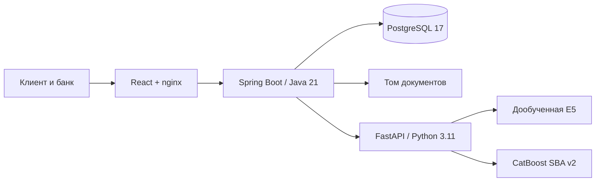

# Кредитный кабинет для бизнеса

Веб-приложение хакатона для оформления кредитной заявки ИП и ООО: от подбора продукта до демонстрационной выдачи. Клиент и сотрудник банка работают в одном интерфейсе с отдельными правами доступа.

**[Код проекта — main](https://github.com/the-shtorm/alpha-future-hackaton/tree/main)** · **[Демонстрация](http://77.91.93.166:3000)**

**[Подробный запуск и демонстрация для проверяющих](docs/hackathon-start.md)** · **[Вся документация](docs/README.md)**

## Быстрый запуск

Подготовьте Docker с Linux-контейнерами и Docker Compose v2. Выполняйте команды из корня репозитория.

Windows PowerShell:

```powershell
powershell -NoProfile -ExecutionPolicy Bypass -File .\scripts\start-demo.ps1
```

Linux, macOS или WSL:

```bash
bash scripts/start-demo.sh
```

Скрипт создаёт `.env`, генерирует пустые пароли и внутренний API-ключ, сохраняет уже заданные значения и выполняет:

```bash
docker compose up --build --detach --wait --wait-timeout 2400
```

Во время первого запуска Docker собирает приложения и получает закреплённые модели с Hugging Face. Модели сохраняются в постоянном кэше. Команда завершается после готовности сервисов.

Откройте **[http://localhost:3000](http://localhost:3000)**. Демо-аккаунты:

| Роль | Логин | Пароль |
|---|---|---|
| Клиент | `demo-owner` | Значение `DEMO_PASSWORD` в `.env` |
| Банк | `demo-bank` | Значение `DEMO_BANK_PASSWORD` в `.env` |

В [инструкции для проверяющих](docs/hackathon-start.md) приведены параметры заявки, работа с документами, настройка учебного макроконтекста, рассмотрение и выдача.

## Что делает проект

- Каталог 15 синтетических кредитных продуктов с версиями условий и фильтрами.
- Предварительная форма из 15 полей, автосохранение, восстановление сессии и сохранённые подборы.
- Проверка применимости продукта и семантическое ранжирование дообученной E5.
- Альтернативные параметры запроса, когда исходные условия не подходят продуктам, с явным подтверждением клиента.
- Полная заявка из 17 полей: 13 общих полей переносятся из предварительной формы.
- Загрузка, скачивание, замена версий и банковская проверка документов.
- Банковский кабинет: очередь, назначение, макроконтекст, проверки, скоринг и решения.
- Обученная CatBoost `sba-scoring-v2`, финансовые проверки, аннуитет и повторная оценка встречного предложения.
- Принятие предложения, подтверждение демонстрационного договора и учебная выдача.
- Неизменяемые поданные ревизии, SHA-256, идемпотентная подача, история статусов и аудит ML-оценок.

## Архитектура



E5 определяет смысловую близость запроса и продукта. CatBoost оценивает вероятность списания на данных SBA; Java объединяет её с параметрами сделки и финансовой политикой. Сервис работает в демонстрационном контуре с синтетическим каталогом.

## Адреса

| Сервис | Адрес |
|---|---|
| Интерфейс клиента и банка | http://localhost:3000 |
| Backend health | http://localhost:8080/health |
| Swagger | http://localhost:8080/swagger-ui/index.html |
| OpenAPI | http://localhost:8080/v3/api-docs |
| pgAdmin | http://localhost:5050 |

Порты настраиваются в `.env`. API интерфейса проксируется nginx через `/api`; FastAPI доступен сервисам во внутренней Docker-сети.

## Доступ и сохранение данных

Клиентские права OWNER/EDITOR/VIEWER привязаны к компании; банковские операции доступны BANK_APPROVER. Браузер использует HttpOnly-cookie и CSRF-защиту, интерфейс и API работают на одном origin. Серверные ключи обращения к моделям передаются только между Java и FastAPI.

PostgreSQL хранит формы, ревизии, решения и сессии. Отдельные Docker-тома сохраняют документы и кэш моделей. Схема управляется Flyway V1–V11, миграционная и прикладная роли БД разделены.

## Документы для команды

- [Конфигурация и жизненный цикл Docker](docs/configuration.md).
- [Архитектура и этапы заявки](docs/backend-plan.md).
- [REST API и права](docs/backend-api.md).
- [Поля форм и типы](docs/backend-fields-v3.md), [финансовые расчёты](docs/data-dictionary.md).
- [E5 и рекомендации](docs/ranking-exchange.md), [кредитный скоринг](docs/credit-scoring.md).
- [База данных](docs/database-design.md), [снимки и версии](docs/form-storage-contract.md).
- [Проверки проекта](docs/validation.md), [сценарии API/Postman](docs/postman-testing.md).
- [Текстовая инструкция для презентации на 6 слайдов](docs/presentation-guide.md).

## Kubernetes и облачная инфраструктура

Из `db-init` включены шаблоны Kubernetes в [infra/kubernetes](infra/kubernetes).
Они описывают размещение ML-сервиса и отдельный этап миграций. Полный локальный
сценарий клиента и банка запускается через Docker Compose по инструкции выше.

| Компонент | Что описано в репозитории |
|---|---|
| [FastAPI Deployment](infra/kubernetes/fastapi/deployment.yaml) | Две реплики, порт через `PORT`, startup/readiness/liveness probes, requests/limits CPU и памяти |
| [Внутренний Service](infra/kubernetes/fastapi/service.yaml) | `ClusterIP`, порт 80, маршрутизация на именованный порт контейнера |
| [Kustomize для FastAPI](infra/kubernetes/fastapi/kustomization.yaml) | Namespace `credit-cabinet`, имя образа и тег выбранного релиза |
| [Шаблон миграционной Job](infra/kubernetes/migrations/job.yaml) | Отдельный релизный шаг для схемы БД, `restartPolicy: Never`, лимит времени и повторов |
| [Kustomize для миграций](infra/kubernetes/migrations/kustomization.yaml) | Подстановка образа миграционного шага и его версии |
| [Параметры БД](infra/kubernetes/secret.env.example) | JDBC URL внешнего PostgreSQL, отдельные роли миграций/приложения, TLS `verify-full` и CA |

Pod-шаблоны задают UID/GID 10001, read-only root filesystem, `seccompProfile: RuntimeDefault`,
отключённый privilege escalation и service-account token, сброшенные capabilities
и отдельный временный том. PostgreSQL CA передаётся через ConfigMap, реквизиты —
через Secret. FastAPI Service предоставляет внутренний адрес для серверных вызовов.

Перед применением шаблонов задаются registry и тег образов, источники E5/SBA,
внутренний API-ключ, доступный кэш моделей, ресурсы ML-процесса и сетевые связи
конкретного окружения. Для миграционной Job выбирается образ/команда, которая
завершает процесс после Flyway. Штатный Java-образ запускает HTTP-сервер и
выполняет Flyway при старте. Внешний доступ, размещение frontend/backend и
хранение их данных настраиваются для выбранного кластера.

Подготовка окружения и порядок применения:
[облачная инфраструктура](docs/cloud-deployment.md).

## Автоматизация разработки

В репозитории есть отдельные workflow для backend/инфраструктуры и ML-контрактов,
Docker test target, `compose.test.yaml`, отчёты JaCoCo и pytest coverage.
Команды ручного запуска и условия проверки реальных моделей описаны в
[docs/validation.md](docs/validation.md). Результаты конкретных прогонов сохраняются
в [отчётах задач](docs/agents/log.md).
