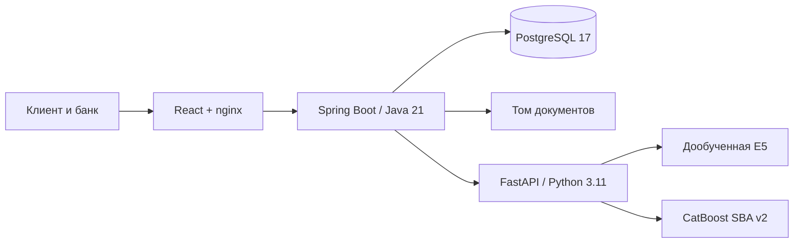

# Кредитный кабинет для бизнеса

Веб-приложение хакатона для оформления кредитной заявки ИП и ООО: от подбора продукта до демонстрационной выдачи. Клиент и сотрудник банка работают в одном интерфейсе с отдельными правами доступа.

**[Подробный запуск и демонстрация для проверяющих](docs/hackathon-start.md)** · **[Вся документация](docs/README.md)**

## Быстрый запуск

Подготовьте Docker с Linux-контейнерами и Docker Compose v2. Выполняйте команды из корня репозитория.

Windows PowerShell:

```powershell
powershell -NoProfile -ExecutionPolicy Bypass -File .\scripts\start-demo.ps1
```

Linux, macOS или WSL:

```bash
bash scripts/start-demo.sh
```

Скрипт создаёт `.env`, генерирует пустые пароли и внутренний API-ключ, сохраняет уже заданные значения и выполняет:

```bash
docker compose up --build --detach --wait --wait-timeout 2400
```

Во время первого запуска Docker собирает приложения и получает закреплённые модели с Hugging Face. Модели сохраняются в постоянном кэше. Команда завершается после готовности сервисов.

Откройте **[http://localhost:3000](http://localhost:3000)**. Демо-аккаунты:

| Роль | Логин | Пароль |
|---|---|---|
| Клиент | `demo-owner` | Значение `DEMO_PASSWORD` в `.env` |
| Банк | `demo-bank` | Значение `DEMO_BANK_PASSWORD` в `.env` |

В [инструкции для проверяющих](docs/hackathon-start.md) приведены параметры заявки, работа с документами, настройка учебного макроконтекста, рассмотрение и выдача.

## Что делает проект

- Каталог 15 синтетических кредитных продуктов с версиями условий и фильтрами.
- Предварительная форма из 15 полей, автосохранение, восстановление сессии и сохранённые подборы.
- Проверка применимости продукта и семантическое ранжирование дообученной E5.
- Полная заявка из 17 полей: 13 общих полей переносятся из предварительной формы.
- Загрузка, скачивание, замена версий и банковская проверка документов.
- Банковский кабинет: очередь, назначение, макроконтекст, проверки, скоринг и решения.
- Обученная CatBoost `sba-scoring-v2`, финансовые проверки, аннуитет и повторная оценка встречного предложения.
- Принятие предложения, подтверждение демонстрационного договора и учебная выдача.
- Неизменяемые поданные ревизии, SHA-256, идемпотентная подача, история статусов и аудит ML-оценок.

## Архитектура



E5 определяет смысловую близость запроса и продукта. CatBoost оценивает вероятность списания на данных SBA; Java объединяет её с параметрами сделки и финансовой политикой. Сервис работает в демонстрационном контуре с синтетическим каталогом.

## Адреса

| Сервис | Адрес |
|---|---|
| Интерфейс клиента и банка | http://localhost:3000 |
| Backend health | http://localhost:8080/health |
| Swagger | http://localhost:8080/swagger-ui/index.html |
| OpenAPI | http://localhost:8080/v3/api-docs |
| pgAdmin | http://localhost:5050 |

Порты настраиваются в `.env`. API интерфейса проксируется nginx через `/api`; FastAPI доступен сервисам во внутренней Docker-сети.

## Документы для команды

- [Конфигурация и жизненный цикл Docker](docs/configuration.md).
- [Архитектура и этапы заявки](docs/backend-plan.md).
- [REST API и права](docs/backend-api.md).
- [Поля форм и типы](docs/backend-fields-v3.md), [финансовые расчёты](docs/data-dictionary.md).
- [E5 и рекомендации](docs/ranking-exchange.md), [кредитный скоринг](docs/credit-scoring.md).
- [База данных](docs/database-design.md), [снимки и версии](docs/form-storage-contract.md).
- [Проверки проекта](docs/validation.md), [сценарии API/Postman](docs/postman-testing.md).

## Облачная инфраструктура

[Шаблоны Kubernetes и миграционной Job](docs/cloud-deployment.md) находятся в `infra/kubernetes/`.
